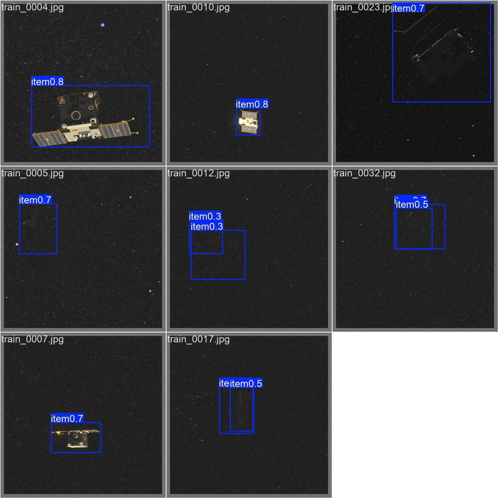
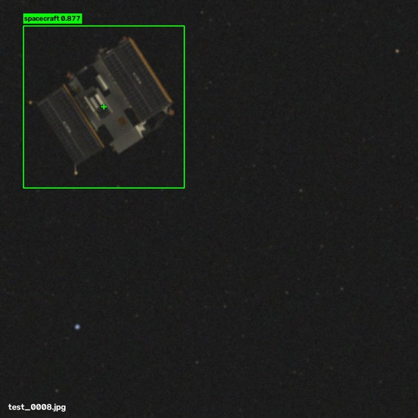
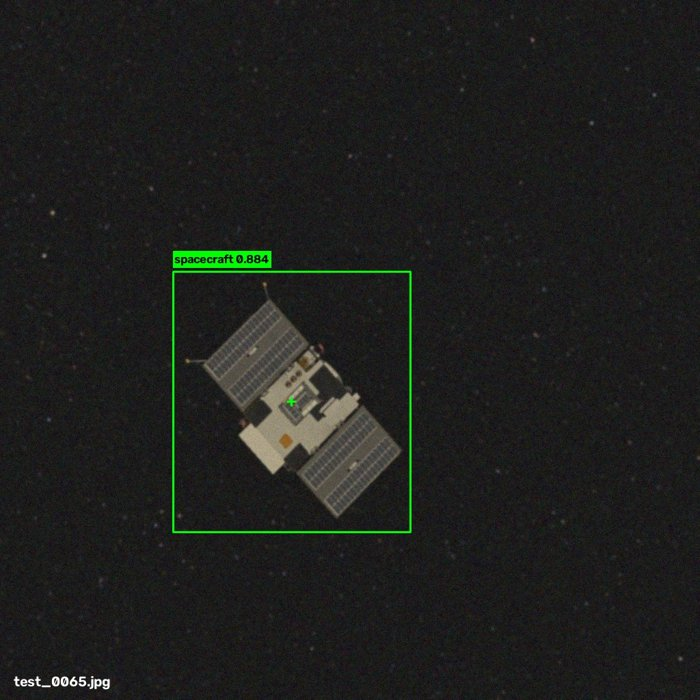
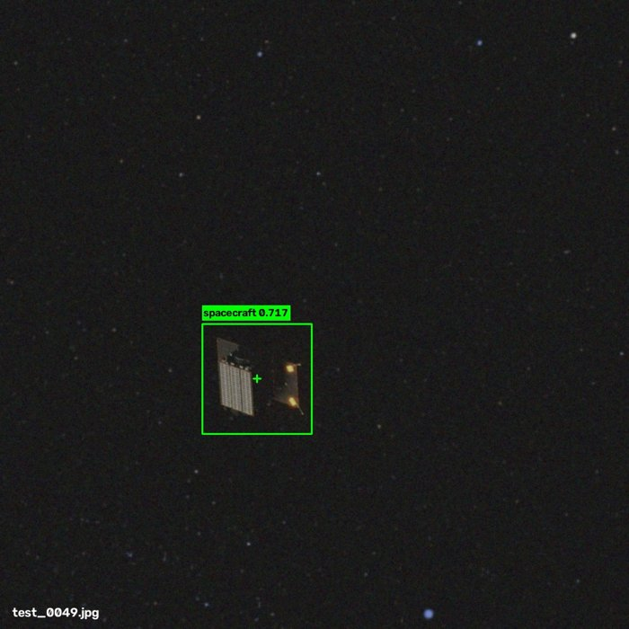
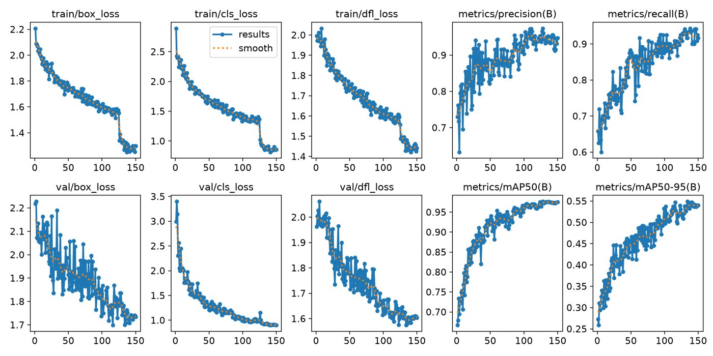
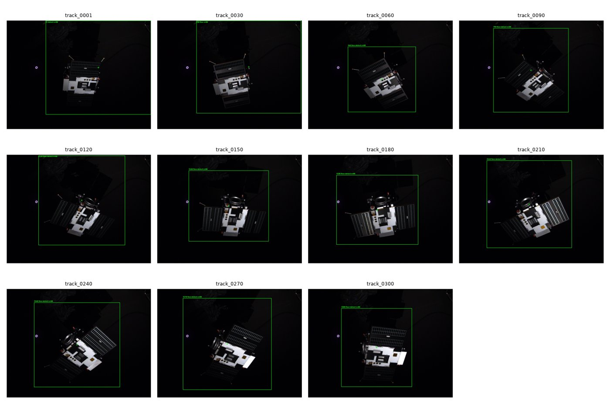
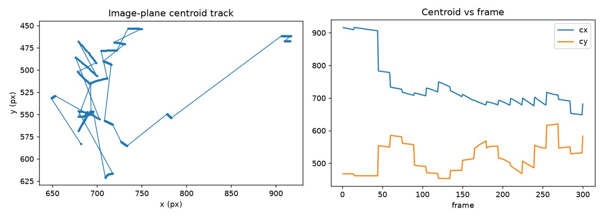

# Vision-Based Relative Navigation for Active Debris Removal

Detecting and tracking an uncooperative satellite from a monocular camera, the first step of a rendezvous with a piece of space debris. This is a take-home assessment for a Vision Systems Engineer role. It covers a detection model, a classical feature tracker and the supporting engineering analysis.

| | |
|---|---|
| **Detector** | YOLOv8s (COCO-pretrained), single class, trained on 480 images |
| **Validation** | mean IoU **0.727**, detection rate (IoU ≥ 0.5) **94.2%**, mAP50 **0.975** |
| **Tracker** | Shi-Tomasi corners + Lucas-Kanade flow, with detector re-initialisation |
| **Hardware** | Trained on a GeForce GTX 1650 in about 1 hour |

## Results

### Detection (validation split)

Validation set: 120 held-out images, confidence threshold 0.15.

| Metric | Value |
|---|---|
| Mean IoU | 0.727 |
| Median IoU | 0.762 |
| Detection rate (IoU ≥ 0.5) | 94.2% (113/120) |
| Median centroid error | 13.3 px |
| Mean centroid error | 29.1 px |
| mAP50 / mAP50-95 | 0.975 / 0.549 |

The mean centroid error is higher than the median because misses count as large errors.



Sample predictions on the degraded test set (blur, darkening, noise). The test labels are hidden, so these are judged visually.

<p>



</p>

Failures concentrate on very dark, low-contrast frames. For example, the three lowest-scoring test images put the box on an empty edge. See [`docs/task3_detection.md`](docs/task3_detection.md).

<details><summary>Training curves</summary>


</details>

### Tracking (300-frame sequence)

A detector box on frame 1 seeds up to 80 corners. Lucas-Kanade optical flow moves the box frame to frame. The detector corrects it every 15 frames or when flow loses its points. Each frame also gets a line-of-sight bearing from the camera intrinsics.

- 300 frames: 280 flow updates, 19 detector updates, 0 flow failures
- Centroid path length is about 1210 px, and the bearing from boresight goes from 6.8° to 1.9°




## Method

- **Model:** YOLOv8s fine-tuned with the first 10 layers frozen, AdamW and a cosine LR schedule.
- **Robustness to domain shift:** the test images are blurred, darkened and noisy. Training used strong brightness/scale jitter, mosaic, MixUp, random erasing, and Blur/CLAHE/ToGray augmentations, plus dropout 0.2 and label smoothing.
- **Loss:** CIoU (box) + BCE (class) + DFL.
- **Split:** 80/20, stratified on box size.

## Repository layout

```
src/        prepare split, train, evaluate, predict on test, track sequence
weights/    best.pt (trained detector)
results/    val_metrics.json, test prediction stats, tracking outputs
docs/       task write-ups and the technical report (PDF)
assets/     figures used in this README
test_predictions.json   COCO-format boxes for the 100 test images
```

## Write-ups

- [Technical report (PDF)](docs/technical_report.pdf)
- [Task 1: mission requirements](docs/task1_mission_requirements.md)
- [Task 2: camera trade-off](docs/task2_camera_tradeoff.md)
- [Task 3: detection](docs/task3_detection.md)
- [Bonus I: tracking](docs/bonus1_tracking.md)
- [Bonus II: onboard architecture and validation](docs/bonus2_architecture.md)

## Reproduce

The images are not in this repo (see Data). Put the dataset in `data_pack/`:

```
data_pack/detection/{train,test}/
data_pack/tracking/sequence/
data_pack/camera.json
```

```bash
python3 -m venv .venv && source .venv/bin/activate
pip install -r requirements.txt

python src/prepare_yolo_dataset.py                          # 480/120 split
python src/train_detector.py                                # optional, ~1 h on a GTX 1650
python src/evaluate_detector.py --weights weights/best.pt   # IoU, detection rate, centroid error
python src/predict_test.py --weights weights/best.pt --conf 0.001
python src/track_sequence.py
```

## Data

Images come from the SPARK 2022 and SPARK 2024 datasets (University of Luxembourg, CVI2/SnT), licensed CC BY 4.0. The test images were degraded for this assessment. The dataset is not redistributed here. Get it from [SPARK-2022](https://huggingface.co/datasets/CVI2-UniLU/SPARK-2022) and [SPARK-2024](https://huggingface.co/datasets/CVI2-UniLU/SPARK-2024).

## AI tools

An AI coding assistant was used for scaffolding, analysis drafting and implementation support.
